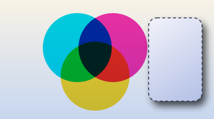

# tpt-canvas

A deterministic, pure-Rust 2D vector graphics API. You write the drawing code once, and it
can produce SVG, PDF, a pixel buffer, a WebGPU command list, or a Canvas2D drawing in the
browser.



The picture comes from [`crates/tpt-gallery/examples/hero.rs`](crates/tpt-gallery/examples/hero.rs),
which draws the same scene to SVG too ([hero.svg](docs/images/hero.svg)).

## What it does

- **One API, several outputs.** `Context` takes the calls, and a backend draws them. The
  backends are SVG, PDF, raster (anti-aliased RGBA), WebGPU (headless command lists with a
  CPU reference executor, plus an optional wgpu adapter), and Canvas2D for the browser.
- **Canvas-style state.** `save`/`restore`, transforms, clips, global alpha, gradients,
  dashes, drop shadows, blend modes, and group opacity.
- **Paths with the curve work done for you.** Arcs (HTML `arc`, `arcTo`, and SVG endpoint
  arcs) are lowered to cubic Béziers, and SVG path strings parse with `Path::from_svg_d`.
  Hit testing is built in.
- **Deterministic.** Flattening uses fixed-order arithmetic and `libm`, and output numbers
  use a fixed precision. The same scene gives the same bytes on every run.
- **`no_std` core.** The core crate needs only `alloc`. CI builds it for `wasm32` and a
  bare-metal ARM target.
- **Zero C-FFI in our code.** CI checks the dependency tree. The only `-sys` crates allowed
  are two pure-Rust or runtime-loaded ones, reached only through the optional wgpu adapter.
- **Labels without a font library.** `StrokeFont` is a built-in stroke font for digits, capitals and a few symbols. It is enough for chart labels until `tpt-text` exists.
- **Honest about gaps.** Every backend counts the calls it cannot draw, in `unsupported()`.
  Nothing is dropped without a count.

## Quick start

Add the core crate and the backend you want. The crates are not on crates.io yet, so for
now use a path or git dependency.

```rust
use tpt_canvas::prelude::*;
use tpt_canvas_svg::SvgBackend;

let mut ctx = Context::new(SvgBackend::new(200.0, 100.0));
ctx.set_fill_paint(Paint::solid(Color::rgb(0.2, 0.4, 0.9)));
ctx.fill_rect(10.0, 10.0, 180.0, 80.0);
let svg: String = ctx.into_backend().finish();
```

Swap `SvgBackend` for `PdfBackend` or `RasterBackend` and the same drawing code produces that
output. To get pixels from the raster backend:

```rust
use tpt_canvas::prelude::*;
use tpt_canvas_raster::RasterBackend;

let mut ctx = Context::new(RasterBackend::new(200, 100));
ctx.set_fill_paint(Paint::solid(Color::rgb(0.2, 0.4, 0.9)));
ctx.fill_rect(10.0, 10.0, 180.0, 80.0);
let png: Vec<u8> = ctx.into_backend().into_pixmap().to_png();
```

Shadows and blend modes use the same calls on every backend:

```rust
use tpt_canvas::prelude::*;
use tpt_canvas::{BlendMode, Shadow};

ctx.set_shadow(Shadow {
    color: Color::rgba(0.0, 0.0, 0.0, 0.6),
    offset: Vec2::new(4.0, 6.0),
    blur: 10.0, // canvas-style: the Gaussian's standard deviation is blur / 2
});
ctx.fill_path(&card);
ctx.clear_shadow();

ctx.set_blend_mode(BlendMode::Multiply);
ctx.fill_path(&overlay);
```

## Which backend draws what

The full table is in [docs/tour.md](docs/tour.md#what-each-backend-cant-draw-yet). In short:

| Feature | Raster | SVG | PDF | Canvas2D | WebGPU |
|---|---|---|---|---|---|
| Fills, strokes, gradients, clips, transforms | yes | yes | yes | yes | yes |
| Blend modes | yes | yes | yes | yes | counted |
| Group opacity | yes | yes | yes (transparency group) | counted | counted |
| Blurred shadows | yes | yes | yes | yes | counted |
| Images | yes | yes (PNG data URI) | yes | yes | counted |
| Patterns | yes | yes | yes | yes | counted |
| Text (glyph runs) | via `GlyphSource` | via `GlyphSource` | via `GlyphSource` | via `GlyphSource` | via `GlyphSource` |

"Counted" means the call is recorded in the backend's `unsupported()` count, not drawn.

## Crates

| Crate | Role |
|---|---|
| `tpt-canvas` | Core: paths, arcs, flattening, stroker, styles, `Context`, `CanvasBackend`, `DisplayList`. `no_std` + `alloc`. |
| `tpt-canvas-svg` | SVG backend. Keeps curves, emits gradients, clips, blend modes and blur filters. |
| `tpt-canvas-pdf` | PDF backend. Content streams, shadings, ExtGState alpha and blend modes, xref. |
| `tpt-canvas-raster` | Raster backend. Anti-aliased coverage, premultiplied RGBA f32, PNG output. |
| `tpt-canvas-webgpu` | Headless WebGPU backend: stencil-then-cover command lists and a CPU executor. |
| `tpt-canvas-wgpu` | wgpu adapter: runs the WebGPU command lists on a real GPU. |
| `tpt-canvas-canvas2d` | Canvas2D backend for the browser (`wasm32` only). |
| `tpt-canvas-facade` | One crate that re-exports the backends behind feature flags. Not published. |
| `tpt-canvas-snapshot` | `assert_render!` for visual regression tests against raster goldens. |
| `tpt-canvas-diff` | Renders one scene through two backends and reports where they disagree. |
| `tpt-canvas-bench` | Criterion benchmarks for the pipeline stages. |
| `tpt-canvas-playground` | A small scene language and the wasm entry point behind the browser playground. |
| `tpt-gallery` | Runnable examples: one scene on every backend, charts, a clock, a PDF table. |

The `tpt-canvas` modules `math`, `color`, `text`, `raster` and `testkit` are stand-ins for
ecosystem crates that do not exist yet. They are inlined, so the public crates depend only on
published code. See [docs/swap-guide.md](docs/swap-guide.md).

## How it compares

These tools overlap with tpt-canvas, but each one is built for a different job. This table
describes their role at a high level, so check their own documentation for current details.

| | tpt-canvas | tiny-skia | vello | lyon |
|---|---|---|---|---|
| Role | One drawing API over several outputs | CPU rasterizer, a Rust port of a subset of Skia | GPU renderer that runs compute shaders through wgpu | Path tessellator (triangles from paths) |
| Output | SVG, PDF, pixels, WebGPU command lists, Canvas2D | Pixels | GPU frames | Triangle meshes |
| Deterministic numerics | Flattening, stroking and tessellation give the same digest natively and on wasm32 (`tests/determinism.rs`) | Not a stated goal | Not a stated goal | Not a stated goal |

## Development

```sh
cargo test --workspace
cargo clippy --workspace --all-targets -- -D warnings
cargo build --target wasm32-unknown-unknown -p tpt-canvas
```

[`justfile`](justfile) has the common tasks (`just check`, `just golden`, `just examples`).
Regenerate golden files only after checking the diff:

```sh
TPT_UPDATE_GOLDEN=1 cargo test --workspace
```

Browser playground: run `just playground`, then serve `docs/` (for example `python -m http.server --directory docs`) and open `playground/`. It takes a small scene script and draws it on a canvas.

Run the examples with `cargo run -p tpt-gallery --example hero`. More detail is in
[docs/tour.md](docs/tour.md), and the rules the code follows are in [CONTRIBUTING.md](CONTRIBUTING.md). Migration guides: [from HTML Canvas](docs/migration-html-canvas.md) and [from tiny-skia](docs/migration-tiny-skia.md).

## Status

Pre-release. The workspace is `publish = false` and has no crates.io release. The CI
workflows are written, and the local checks pass, but the jobs have not yet run on GitHub.
See [TODO.md](TODO.md) for what is done and what is not, and [spec.txt](spec.txt) for the
original specification.

## License

Dual-licensed under [MIT](LICENSE-MIT) or [Apache-2.0](LICENSE-APACHE), at your option.
